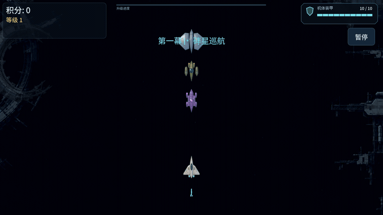
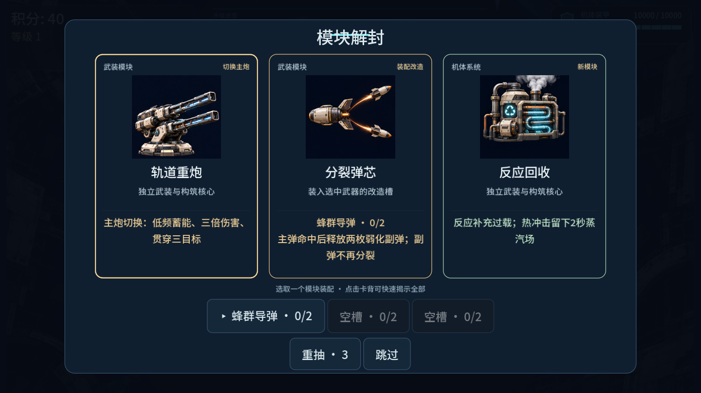
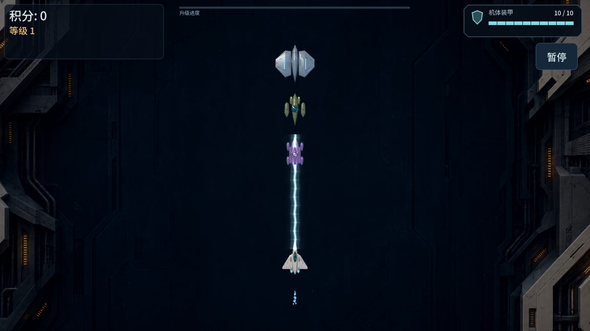

# No Survivor Game

[ブラウザで遊ぶ](https://mocas-12.github.io/no-survivor-game/?v=flight-pulse-20261106) · [English](./README.md) · [简体中文](./README.zh-CN.md)

三幕のSFサバイバルシューティング。武器の組み合わせ、分岐する機体、変形するボス。



## 現行版 · 多層背景とパルス武装

- 三幕の航路、ランダムな通常ボス二体と最終OMEGA。勝利後はエンドレスへ進めます。
- 突撃・護衛・攻城の三機体。進化コアを三回取得し、系統を維持して艦体段階5/10/15と専攻を選択。
- 六種の主武器、二つの補助枠、武器ごとに独立した二つの改造枠。
- 48枚のモジュールカード、新規イラスト25点、各ラン三回の再抽選とスキップ。
- 12種の遭遇パターンと、修理・機雷・防壁・分裂・牽引・側面爆撃の追加敵。リスク契約は任意です。
- ボスの立体モデルと連続的なP2展開、OMEGAのP3、小型で識別しやすい敵弾。
- image-2による遠景と独立した側面景物。背景全体の縦タイルや鏡像反復を廃止し、四秒で章をつなぎます。
- パルスビームは蓄積・発射・流動・収束を同期。専用音、命中音、砲口動作を追加。遮るものがなければ画面外まで届き、三体目の貫通対象で終点を表示します。
- 補給船イベントを中央に配置。一時停止中もボタンが動作し、背景・ビーム・音声が同期停止します。

 

## 操作と検証範囲

PCはマウス、モバイルは左側の仮想スティックで移動。射撃は自動です。記録は端末に保存されます。

公開版は`main/docs`から配信し、バージョン付きファイル名で旧データの混在を防ぎます。初回は約72 MBのゲームデータとエンジンを取得します。

自動テストは戦闘、改造、段階変化、停止・再開と描画上限を検証します。加速ボットは人間の難易度評価ではありません。実機の発熱・性能と音声ミックスは未検証です。一部のヘッドレス終了時に既存のリソース警告が残ります。画像は実エンジンによる制御された演出例です。

## Source and verification

- [Full combat redesign](./docs/FULL-COMBAT-REDESIGN.md)
- [Flight and pulse beam changes](./docs/FLIGHT-PULSE.md)
- [Version identity and package SHA-256](./docs/build-info.json)
- [Export and release conventions](./EXPORTING.md)

```sh
git clone https://github.com/Mocas-12/no-survivor-game.git
cd no-survivor-game
# Open project.godot in Godot 4.7 and press F5.
godot --headless --path . --script tools/flight_pulse_test.gd
godot --headless --path . --script tools/campaign_ui_test.gd
godot --headless --path . --script tools/full_plan_test.gd
godot --headless --path . res://tools/smoke_test.tscn
```

```sh
# Install the matching Godot Web export templates first.
mkdir -p build/expansion
godot --headless --path . --export-release Web build/expansion/index.html
node tools/serve_expansion.cjs
# http://127.0.0.1:8318/
```

## License and credits

- Code and project-generated assets: [MIT](./LICENSE), © Mocas-12.
- Retained legacy spacecraft: Quaternius Ultimate Spaceships, CC0; original licenses remain in the asset folders.
- Noto Sans SC subset and ZCOOL KuaiLe: SIL Open Font License; [font license](./assets/fonts/NotoSansSC-OFL.txt).
- Godot Engine 4.7: MIT.
