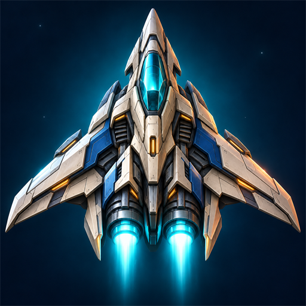
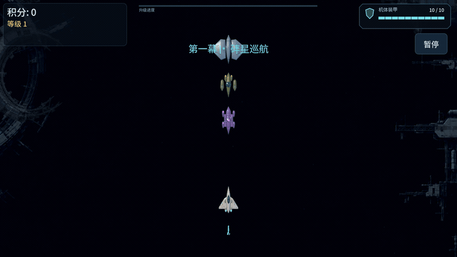
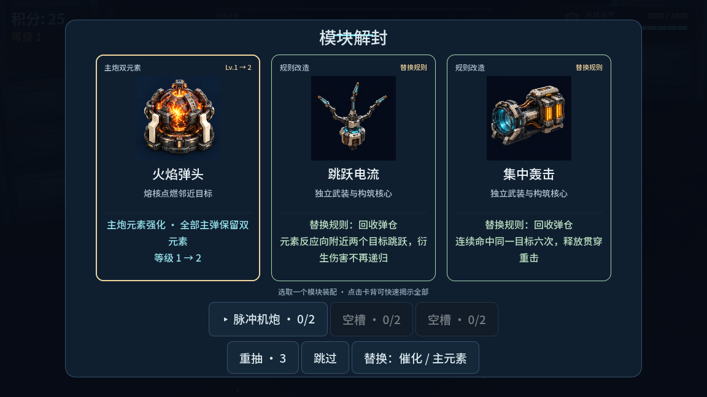
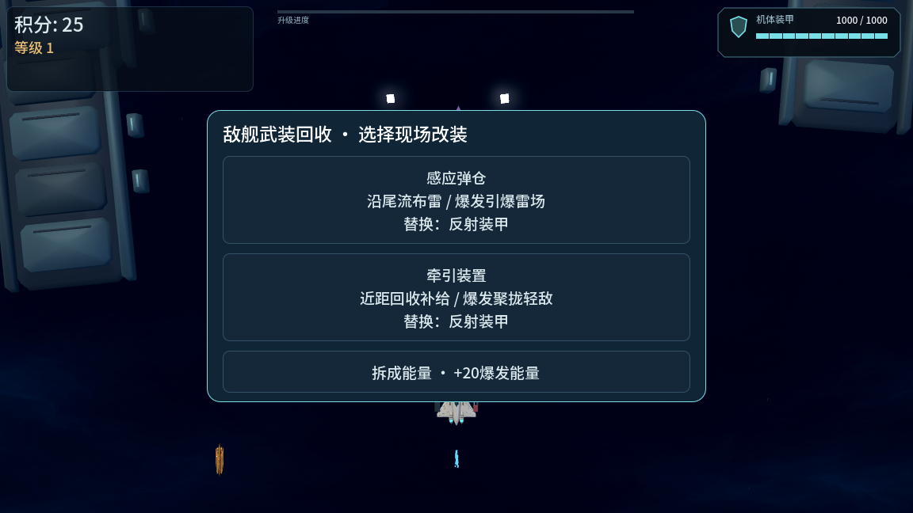

<div align="center">


# No Survivor Game

[Play in Browser](https://mocas-12.github.io/no-survivor-game/?v=salvage-20261110) · [简体中文](./README.zh-CN.md) · [日本語](./README.ja-JP.md)

A three-act sci-fi survivor with modular weapons, branching spacecraft and transforming bosses.


</div>

## Current version · salvage builds (2026-11-10)

- **Denser opening:** immediate light formations, a first draft after 12 seconds, and paced reinforcement rather than long empty stretches. The first recoverable transport arrives around 24 seconds; later drops require approaching the wreckage.
- **Dual-element main fire:** each primary shot carries both selected elements. Five elements produce ten pair reactions; a third element replaces the chosen slot. Auxiliary weapons retain their own loadouts.
- **Six recoverable hardware types:** cannons, mines, reflective armor, tractor equipment, tail bombers and splitters. Two mounted slots visibly attach enemy hardware to the wings; a full loadout shows its replacement target, while recycling grants burst energy.
- **One configurable active burst:** select the main weapon or installed hardware as the burst source. Overclock, piercing fire, beam amplification, reflection, mine detonation, gathering and bombing produce different four-second attacks.
- **Six rule modifications, two active slots:** returning-ammo recovery, reaction jumps, shield-death copying, movement-triggered side fire, focused-hit breaches and grazing energy. Taking a third rule explicitly replaces an existing rule.
- **Five battlefield opportunities:** transports, repair chains, captured turrets, escorted convoys and breakthrough gaps. Captured turrets provide real covering fire; gaps temporarily displace light enemies on one side.

- **Three-act campaign:** shattered orbit, storm front and mothership approach. Each run faces two shuffled regular bosses followed by OMEGA; endless mode remains available after victory.
- **Three starting frames:** assault, escort and siege. Three evolution-core pickups advance hull tiers 5/10/15, retain the chosen family and add specialization choices.
- **Six primary weapons:** pulse cannon, rail cannon, homing missiles, returning blades, pulse beam and proximity mines. Main weapon and two auxiliary slots keep independent two-modification loadouts; full slots show what will be replaced.
- **54 module cards:** illustrated upgrades and six new rule illustrations, three rerolls per run, optional skips, elemental payloads and combo discoveries. Reaction-generated attacks are bounded to avoid recursive spawning.
- **Varied encounters:** twelve encounter patterns and six additional tactical roles: repair, minelaying, shield projection, splitting, salvage attraction and flank bombing. Optional contracts trade additional pressure for repairs and firepower.
- **Boss presentation:** rebuilt volumetric fleet, moving mechanical sections and approximately two-second P2 deployments; OMEGA also has P3. Enemy bullets have smaller, distinct silhouettes.
- **Layered flight:** soft distant artwork behind real beveled station geometry, with at most twelve tiny directional dust marks. The background never vertically tiles or mirrors. Chapters blend over four seconds while old scenery departs; low quality hides secondary trim.
- **Pulse beam:** charge → burst → flowing sustain → cooldown, dedicated layered audio and contact sounds, animated energy filaments, muzzle recoil and world-space range. An unobstructed beam exits the view; the third penetrating contact provides a visible endpoint.
- **Reliable pause and UI:** centered convoy contracts remain clickable while paused. Background, pulse clocks and audio pause together. Illustrated cards, armor HUD and a capped damage-contribution recap support build readability.

 

## Controls and limits

Desktop: move the mouse to pilot; firing is automatic. Press Space or the burst button at 100 energy. Use the source selector below it to choose the next burst. Mobile: use the left-side virtual joystick and right-side burst button. Esc or Pause opens the menu. Save data and discovery history stay on the device.

The game is exported into `main/docs` with versioned loader, WASM and PCK names to avoid stale game packages. First load downloads roughly 77 MB of game data plus a 40 MB engine; later startup depends on connection and browser caching. The deployed version is identified by [build-info.json](https://mocas-12.github.io/no-survivor-game/build-info.json); GitHub Pages can lag behind a source merge.

Automated checks cover combat, modules, phase transitions, pause/resume, touch controls and bounded effects. Eight counted suites passed 632 assertions, alongside campaign-UI and smoke checks. Three accelerated invulnerable references completed the campaign; three damage-enabled opening sessions reached their 180-game-second test limit. These are not player-retention or balance results. Browser mouse, emulated touch and WebAudio checks passed, but mobile stress emulation still shows frame drops. Physical-phone heat/performance and the final audio mix require human device testing. Some headless exits retain existing ObjectDB/resource warnings. Screenshots labelled controlled presentations are staged in the actual engine, not proof of natural campaign progression.

## Source and verification

- [Full combat redesign](./docs/FULL-COMBAT-REDESIGN.md)
- [Salvage builds: implementation and validation](./docs/SALVAGE-RUN.md)
- [Flight and pulse beam changes](./docs/FLIGHT-PULSE.md)
- [Version identity and package SHA-256](./docs/build-info.json)
- [Export and release conventions](./EXPORTING.md)

```sh
git clone https://github.com/Mocas-12/no-survivor-game.git
cd no-survivor-game
# Open project.godot in Godot 4.7 and press F5.
godot --headless --path . --script tools/flight_pulse_test.gd
godot --headless --path . --script tools/campaign_ui_test.gd
godot --headless --path . --script tools/full_plan_test.gd
godot --headless --path . --script tools/salvage_run_test.gd
godot --headless --path . --script tools/salvage_campaign_test.gd
godot --headless --path . res://tools/smoke_test.tscn
```

```sh
# Install the matching Godot Web export templates first.
mkdir -p build/expansion
godot --headless --path . --export-release Web build/expansion/index.html
node tools/serve_expansion.cjs
# http://127.0.0.1:8318/
```

## License and credits

- Code and project-generated assets: [MIT](./LICENSE), © Mocas-12.
- Retained legacy spacecraft: Quaternius Ultimate Spaceships, CC0; original licenses remain in the asset folders.
- Noto Sans SC subset and ZCOOL KuaiLe: SIL Open Font License; [font license](./assets/fonts/NotoSansSC-OFL.txt).
- Godot Engine 4.7: MIT.
