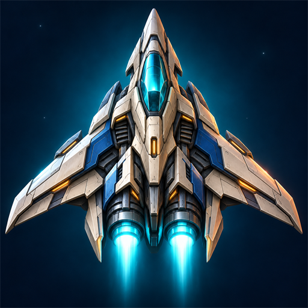
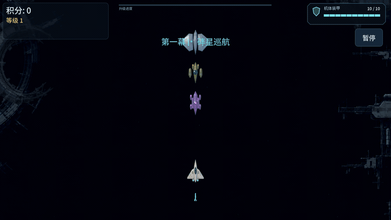
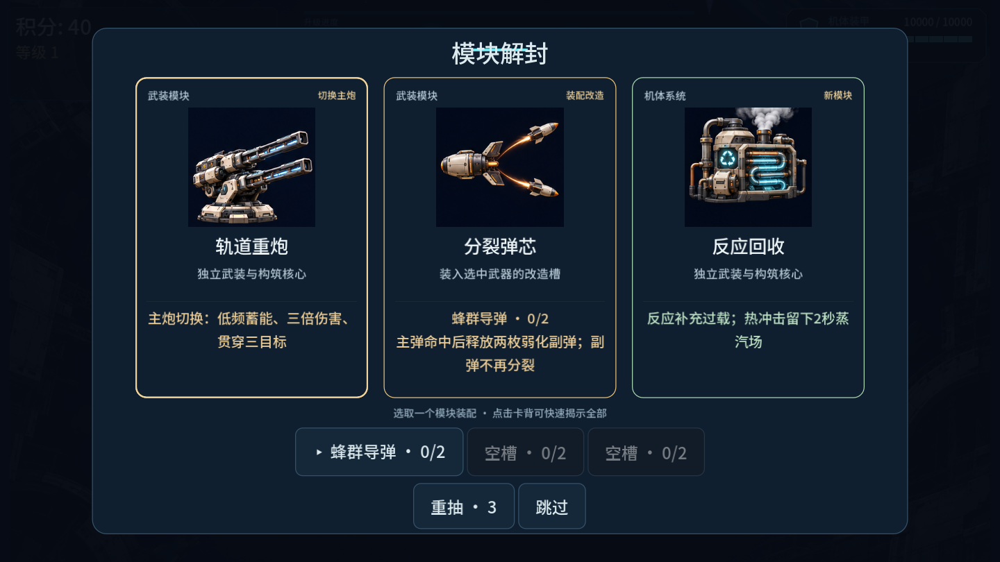
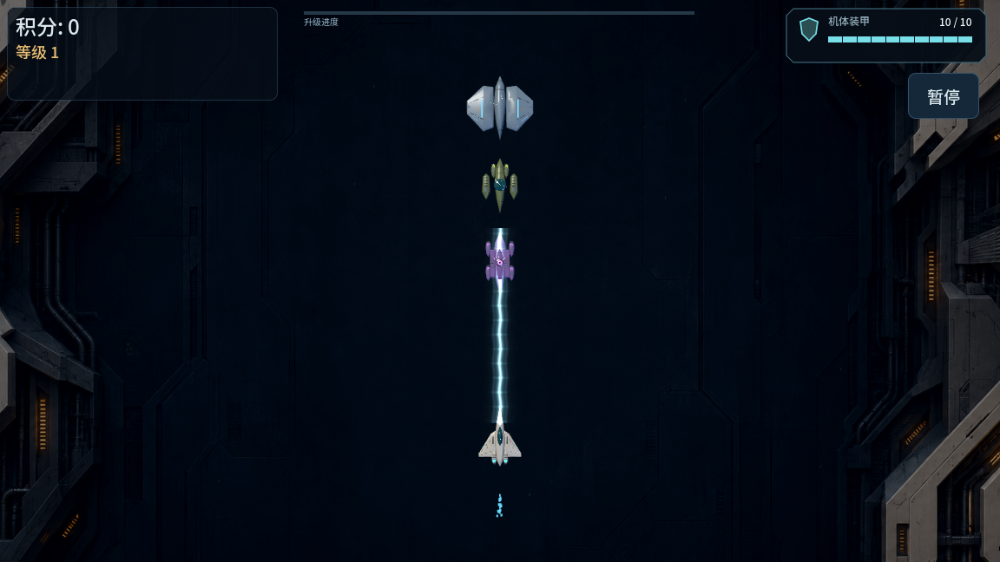

<div align="center">


# No Survivor Game

[在线试玩](https://mocas-12.github.io/no-survivor-game/?v=flight-pulse-20261106) · [English](./README.md) · [日本語](./README.ja-JP.md)

三幕科幻生存射击：自由武器构筑、分支机型与机械暴走Boss。


</div>

## 当前版本 · 分层航行与脉冲武装

- **三幕航线：**碎星巡航、风暴防线、母舰深域。每局面对两只打乱选择的常规Boss和终局OMEGA；胜利后可继续无尽模式。
- **三种起始机型：**突击、护航、攻坚。拾取三次进化核心，依次进入5/10/15舰体阶段，保留机型并选择不同专精。
- **六类主武器：**脉冲机炮、轨道重炮、蜂群导弹、回旋刃、脉冲光束、感应雷。主炮与两个辅助槽各保留两个独立改造，装满后明确提示替换目标。
- **48张模块卡：**新增25张原创插画，每局三次重抽，也可跳过。元素弹芯、辅助武装和模块联动共同构筑；衍生攻击有数量和递归保护。
- **多样遭遇：**12组遭遇模式，新增维修、布雷、护盾投射、分裂、牵引、侧翼轰炸六类职责。风险委托可接受或绕行，额外压力换取维修与火力。
- **Boss表现：**新立体舰体、独立机械分组，约两秒连续展开进入P2，OMEGA还具有P3；敌弹形状更小、更容易辨认。
- **分层飞行背景：**image-2制作远景与独立景物，远景不再上下平铺或镜像；侧边景物单次经过，最多12条微小星尘提供速度感。章节用四秒渐变与景物退场衔接。
- **脉冲光束：**聚能、爆发、能量流动、收束四阶段，独立发射与命中音效、炮口动作、升级后的束体表现；无阻挡时延伸出视野，达到第三个贯穿目标时显示撞击终点。
- **暂停与界面：**补给舰事件居中显示，暂停时按钮仍可点击；背景、脉冲时钟和音效同步暂停。插画选卡、装甲仪表与火力贡献结算帮助理解构筑。

 

## 操作与验证边界

电脑移动鼠标驾驶，武器自动发射；手机使用左侧虚拟摇杆。Esc或暂停按钮打开菜单。最高分和发现记录保存在本机。

在线版本由`main/docs`发布，加载器、WASM与PCK使用带版本号的文件名，避免更新后仍读到旧包。首次需要下载约72 MB游戏数据及引擎，加载速度取决于网络与浏览器缓存。

自动检查覆盖构筑、战斗、Boss阶段、暂停恢复、触屏和特效上限。加速机器人只验证战役可走通，不代表真人留存或机型强度均衡；实体手机性能、发热及最终音效混音仍需人工复核。部分无头退出保留既有ObjectDB/资源引用警告。展示图由真实引擎受控摆设拍摄，不代表自然通关过程。

## Source and verification

- [Full combat redesign](./docs/FULL-COMBAT-REDESIGN.md)
- [Flight and pulse beam changes](./docs/FLIGHT-PULSE.md)
- [Version identity and package SHA-256](./docs/build-info.json)
- [Export and release conventions](./EXPORTING.md)

```sh
git clone https://github.com/Mocas-12/no-survivor-game.git
cd no-survivor-game
# Open project.godot in Godot 4.7 and press F5.
godot --headless --path . --script tools/flight_pulse_test.gd
godot --headless --path . --script tools/campaign_ui_test.gd
godot --headless --path . --script tools/full_plan_test.gd
godot --headless --path . res://tools/smoke_test.tscn
```

```sh
# Install the matching Godot Web export templates first.
mkdir -p build/expansion
godot --headless --path . --export-release Web build/expansion/index.html
node tools/serve_expansion.cjs
# http://127.0.0.1:8318/
```

## License and credits

- Code and project-generated assets: [MIT](./LICENSE), © Mocas-12.
- Retained legacy spacecraft: Quaternius Ultimate Spaceships, CC0; original licenses remain in the asset folders.
- Noto Sans SC subset and ZCOOL KuaiLe: SIL Open Font License; [font license](./assets/fonts/NotoSansSC-OFL.txt).
- Godot Engine 4.7: MIT.
